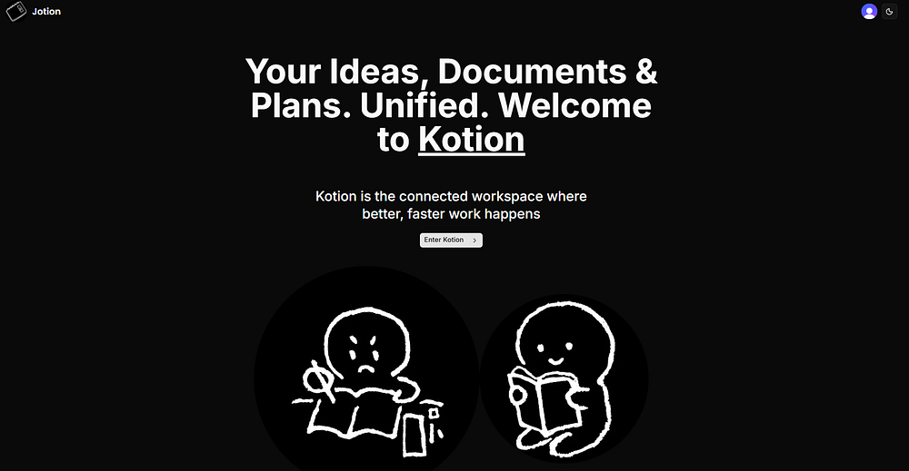
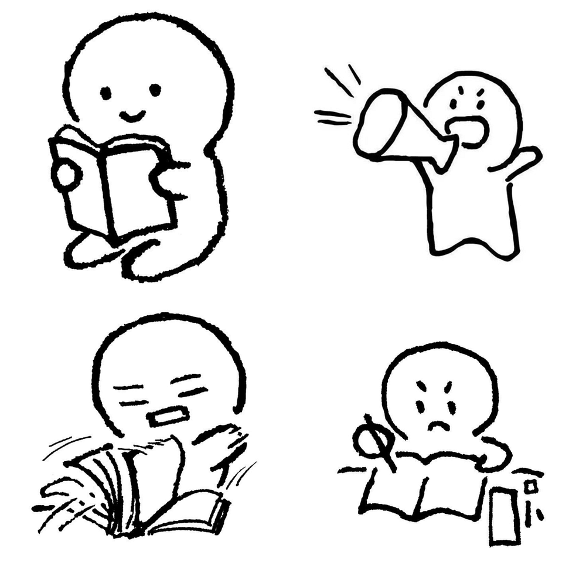
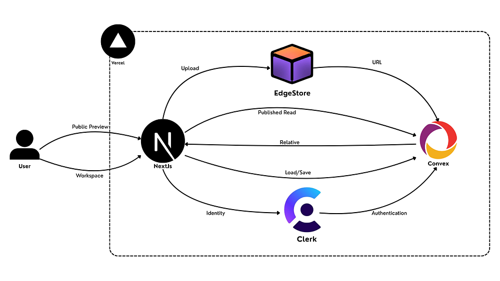

# Notion Clone App Project

So I want to talk about the recent project I did. I created a Notion clone and named it "Kotion". Well… because it's "Kaustubh's Notion". Get it? Get it?

This project is not my own. I followed the [Full Stack Notion Clone tutorial by Code with Antonio](https://www.youtube.com/watch?v=0OaDyjB9Ib8).

I tried to follow this tutorial and code by myself without using AI. But I did use it in the middle to resolve the errors that I spent much much time trying to figure out on my own but couldn't.

I also have a mascot character!! I call him Chintu. I borrowed that character from Pinterest. My main purpose for choosing him was to add some personal touch to this project.

## Tools I Used

In this project, following the tutorial, I used Next.js App Router with React for the frontend, Tailwind CSS and TypeScript for styling. The database is hosted on Convex, which is also used for server functions. Clerk provides authentication, and EdgeStore is used for file storage.

I've deployed this app on Vercel.

## Features

This is similar to Notion, in which you can create, delete, or publish a note document.

The published note document can be shared via a generated link. You can see my [published document here](https://kotion-ebon.vercel.app/preview/j5797z0xkkjbzw7za5t3d0br8n8fce6m).

This is also the first time I found out about Convex, Clerk, and EdgeStore. They provide pretty good resources to use in free tiers that you can use for your personal projects.

## What I Learned

This project also taught me about organizational folders and dynamic route segments you can create.

**Organizational folders:** You can create a group of routes to give them the same layout and styling, but it is not visible in the URL.

Eg. Here the main homepage is organized inside the `(marketing)` folder, and it has a different set of styles. But you will not see `/marketing` in the homepage URL.

**Dynamic Route Segments:** This is used to route the page based on a parameter passed in the URL.

Eg. Different documents for different users. Here it is used to load the document using the `[documentId]` route, and this route depends on the `userId`.

I know, I know… this must be common knowledge for many developers. But this was something new to learn for me.

I have listed all the relevant links at the bottom. If anyone is reading this, do check it out and give me reviews. 👍

## Links

- [Full Stack Clone Tutorial by Code with Antonio](https://www.youtube.com/watch?v=0OaDyjB9Ib8)
- [My Kotion App](https://kotion-ebon.vercel.app/)
- [GitHub Repository](https://github.com/steel3301/kotion)

Also check out my [Portfolio](https://warme.runs-on.dev), [GitHub](https://github.com/steel3301/), and [LinkedIn](https://www.linkedin.com/in/kaustubh-warme/).